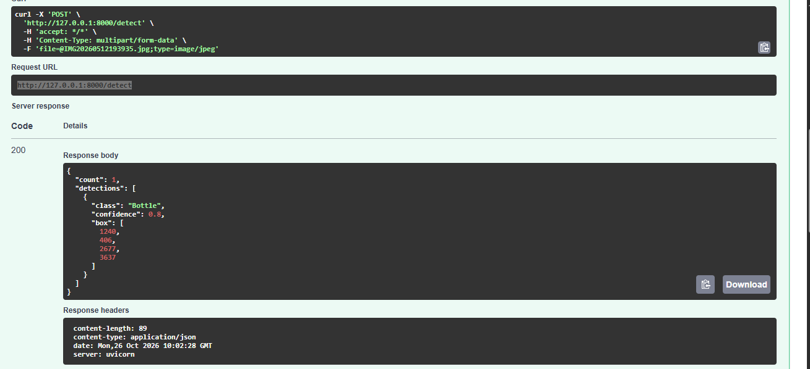
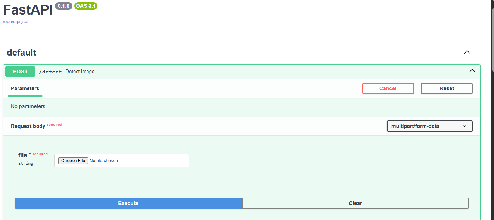

# Bottle Detection API

A FastAPI service that detects bottles in an image using a custom-trained YOLOv8n model.

Part of my [Bottle Detection project](https://github.com/Muaz-Hossain/bottle-detection), which also has a live Streamlit demo: https://bottle-detection-ihnf46gq3alwszitg36pug.streamlit.app

## What it does

- Accepts an image upload (JPEG or PNG)
- Runs YOLOv8n inference with my trained weights (`best.pt`)
- Returns the detected bottles as JSON: class, confidence and bounding box

The model was trained on 150+ annotated bottle images and reached 92% mAP@0.5 on my validation set.

## Tech stack

Python, FastAPI, Uvicorn, Ultralytics YOLOv8, OpenCV, NumPy

## How to run

```
pip install -r requirements.txt
uvicorn main:app --reload
```

Then open http://127.0.0.1:8000/docs, choose **POST /detect**, click **Try it out**, upload an image and click **Execute**.

## Endpoint

`POST /detect`: send an image file in the `file` field.

Example response:

```json
{
  "count": 1,
  "detections": [
    {
      "class": "Bottle",
      "confidence": 0.8,
      "box": [1240, 406, 2677, 3637]
    }
  ]
}
```

`box` is `[x1, y1, x2, y2]` in pixels of the uploaded image.

## Screenshots

Test result on `/docs`:



Upload form:



## Limitations

The model was trained mostly on one bottle type, so it may miss other bottle shapes and colors. I plan to expand the dataset to improve this.

## Next steps

- Confidence threshold option
- Return the image with boxes drawn on it
- Docker container
